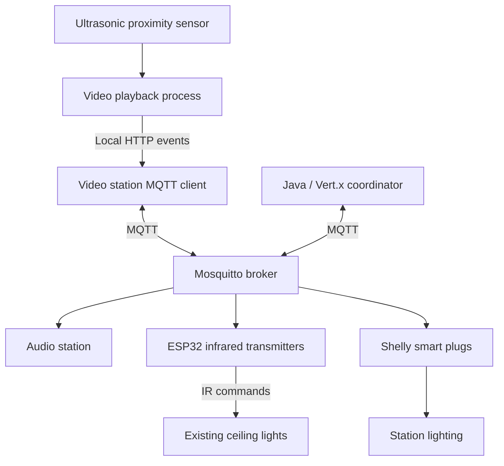

# VillaSilvia — IoT Smart Museum

An IoT system developed for the **Bonci room at the Museum of Mechanical Music, Villa Silvia-Carducci, Cesena**, to coordinate video, audio and lighting during guided visits.

The project connects previously independent devices through a local MQTT network. Proximity sensors trigger multimedia stations, while a central coordinator adjusts ambient audio and lighting to support the guide's narration.

Developed as part of my **BSc thesis in Computer Science and Engineering at the University of Bologna**, academic year **2024/2025**.

**Technologies:** Java · C++ · Vert.x · MQTT · Mosquitto · Raspberry Pi · ESP32 · Pi4J · JavaFX · PlatformIO

[Read the thesis (Italian)](Tesi.pdf)

## Project highlights

- **Real museum installation:** the thesis documents on-site integration and testing of four video stations, six ceiling lights and one audio station.
- **Event-driven coordination:** video playback events drive lighting changes and ambient audio control through MQTT.
- **Embedded integration:** Raspberry Pi stations combine media playback, ultrasonic proximity sensing and network communication.
- **Retrofitting existing lights:** ESP32 modules translate MQTT commands into infrared signals, preserving the original ceiling fixtures.
- **Local operation:** the system communicates over a dedicated local network without requiring an Internet connection during visits.
- **Room controls:** sleep, wake and shutdown commands support daily operation.

## How a visit works

1. A video station detects a nearby person through its ultrasonic sensor, allowing the guide to trigger playback without a visible control panel.
2. The station starts the video and reports a `triggered` event, including its lighting configuration.
3. The coordinator schedules commands for the station's Shelly-controlled lights. The introductory station also dims the ceiling lights and stops ambient audio.
4. When playback finishes, the station reports an `ended` event. The coordinator applies the corresponding room logic; the piano station's completion restores ceiling lighting and ambient audio.

The implementation contains station-specific behavior, including a separate piano-player variant. It is tailored to the Bonci room's visit sequence.

## Architecture



The thesis deployment uses a Raspberry Pi coordinator to host both the broker and the orchestration application. The thesis describes a coordinator-hosted Wi-Fi hotspot; the repository also contains router configuration notes and deployment-specific network addresses.

| Component | Role | Main technologies |
| --- | --- | --- |
| Central coordinator | Processes events and issues room-level commands | Java, Vert.x, MQTT |
| MQTT broker | Routes messages between devices | Mosquitto |
| Four video stations | Detect proximity, play media and report events | Raspberry Pi, Java, Pi4J, local HTTP |
| Audio station | Plays ambient audio and responds to room commands | Raspberry Pi, JavaFX MediaPlayer, Vert.x |
| Ceiling-light controllers | Translate network commands into infrared signals | ESP32, C++, Arduino, PlatformIO |
| Local lighting | Switches station lights according to configured timings | Shelly devices, MQTT RPC |
| IR receiver utility | Captures the original remote-control codes during setup | ESP32, IR receiver |

## Repository structure

```text
VillaSilvia/
├── mqttServer/                 # Coordinator and preliminary web dashboard
├── videoPlayer/
│   ├── MqttVideoClient/         # MQTT client, local HTTP API and process control
│   ├── main-app/               # Video playback, proximity sensing and media scanning
│   └── PlayVideo-piano.java     # Station-specific piano variant
├── AudioPlayer/                # Ambient audio playback and MQTT commands
├── ESP32IR/                    # MQTT-to-IR transmitter firmware
├── ESP-IR_Receiver/             # IR code acquisition utility
├── DeployDocs/                 # Network, device and deployment notes
└── Tesi.pdf                    # Thesis: design, implementation and testing
```

## Current implementation and thesis scope

The repository has differences from the implementation described in the thesis:

- **Video playback:** the thesis describes a JavaFX video player. The current `videoPlayer/main-app` implementation launches **mpv** for video playback, **feh** for a background image and **socat** for mpv IPC. JavaFX remains in use for audio playback and in the Maven dependencies.
- **MQTT naming:** current code uses the `bonci/...` topics listed below. Earlier thesis examples use `smartroom/...` topics.
- **Media discovery:** `UsbMediaScanner` currently reads a configured local directory named `USB`; it does not automatically discover arbitrary mounted USB devices.
- **Dashboard:** `mqttServer` includes static web resources and device-status endpoints. The call that updates the device-status registry is commented out, so this should be treated as a preliminary interface rather than a completed monitoring dashboard.

## MQTT interface

Topics and payloads below reflect the current source code.

| Topic | Purpose | Payload |
| --- | --- | --- |
| `bonci/videoPlayer/event` | Video playback events | JSON containing `deviceId`, `event` and, for triggers, `lights` |
| `bonci/videoPlayer/command` | Video station lifecycle | `SLEEP`, `WAKE`, `SHUTDOWN` |
| `bonci/audioPlayer/command` | Ambient audio control | `ON`, `OFF`, `PAUSE`, `SHUTDOWN` |
| `bonci/plafoniere/command` | Commands to all ceiling-light controllers | `ON`, `OFF`, `LIGHT_UP`, `LIGHT_DOWN`, `WARM_UP`, `COLD_UP` |
| `bonci/<deviceId>/command` | Initialization of a specific ceiling-light controller | `STARTING` |
| `bonci/power/command` | Room-level lifecycle control | JSON with `command`: `sleep`, `wake` or `shutdown` |
| `bonci/online_data` | Device connection announcements | JSON device metadata |
| `<shelly-id>/rpc` | Local light switching | Shelly `Switch.Set` JSON RPC |

For each video station, `light.json` defines the associated Shelly devices and their switching delays in seconds. For example:

```json
[
  {
    "id": "YOUR_SHELLY_DEVICE_ID",
    "onAfter": 1,
    "offAfter": 30
  }
]
```

Use the actual MQTT identifier of the Shelly device. In the current coordinator, only strictly positive delays schedule a switching command; `0` does not mean "execute immediately".

## Setup and build

This repository contains installation-specific applications and configuration notes. Running the full system requires the target devices, wiring, media assets and adaptation of the paths and identifiers in the source.

### Requirements

- Raspberry Pi devices running a compatible Linux environment, with a graphical session for multimedia playback.
- JDK 17 and Maven; JavaFX runtime/native libraries compatible with the target architecture for the audio application.
- A reachable Mosquitto broker on the local network.
- Pi4J-compatible GPIO access and correctly wired ultrasonic sensors.
- `mpv`, `feh`, `socat` and `unclutter` for the current video implementation; display-control utilities required by the deployment scripts.
- PlatformIO with the ESP32 Arduino framework for the IR modules.
- Compatible Shelly devices, IR-controlled ceiling fixtures and the required media files.

### Configuration

Before building or starting the applications:

1. Set the broker address consistently across the Java clients and ESP32 firmware. The coordinator currently connects to `localhost`; client addresses are installation-specific.
2. Assign each station and IR controller its intended device ID. Station names are used by the coordinator's visit logic.
3. Adapt absolute filesystem paths, launch scripts, display/audio settings and `systemd` service definitions to the target machines.
4. Configure Wi-Fi, GPIO assignments and IR codes for the actual hardware.
5. Supply the media files. The video scanner expects an `.mp4`, a `.jpg` and a non-empty `light.json` in its configured directory. The audio implementation currently loads `audio/test.mp3` relative to its working directory.

### Build commands

From the repository root, the Java applications are separate Maven projects:

```bash
mvn -f mqttServer/pom.xml clean package
mvn -f videoPlayer/MqttVideoClient/pom.xml clean package
mvn -f videoPlayer/main-app/pom.xml clean package
mvn -f AudioPlayer/pom.xml clean package
```

Build the ESP32 projects with PlatformIO:

```bash
pio run -d ESP32IR
pio run -d ESP-IR_Receiver
```

These commands follow the committed project structure; they are not a complete installation procedure. In particular, the video process manager expects a `target/distribution/run.sh` launcher, while the Maven distribution-assembly steps are commented out. Prepare the launcher and runtime files, or adapt the process manager, before starting the video service.

Deployment references:

- [General device and network notes](DeployDocs/)
- [Coordinator configuration](mqttServer/configuration.txt)
- [Video station configuration](videoPlayer/videoPlayerConfiguration.txt)
- [Audio launch script](AudioPlayer/start.sh)

The coordinator and each video station's local HTTP service both use port `8080` on their respective hosts. Running them together on a single development machine requires changing one of the ports and the corresponding client configuration.

## Validation

The thesis documents three stages of functional validation:

1. **Local component tests:** video and audio playback, sensors, local lights and infrared transmission.
2. **MQTT integration tests:** connection to the local network, topic subscriptions and remote execution of commands.
3. **On-site system testing:** initial tests with a reduced configuration, followed by the complete installation in the Bonci room with four video stations and six ceiling lights.

The reported checks cover coordination between subsystems and room-level sleep, wake and shutdown behavior. They are functional integration tests, not quantitative latency, energy-consumption or long-term reliability benchmarks.

## Further development

- Complete the operator dashboard and enable device-status updates.
- Move deployment parameters out of the source code into configuration files.
- Consolidate station variants and deployment scripts into a reproducible installation workflow.
- Extend automated checks for message handling and coordination logic.
- Adapt the architecture to additional rooms and multimedia devices.

## Author and academic context

**Riccardo Polazzi** — BSc in Computer Science and Engineering, University of Bologna, Cesena Campus.

**Thesis:** *Applicazione di tecnologie IoT per la realizzazione di Smart Museum: il caso di studio di Villa Silvia*.

**Supervisor:** Prof. Alessandro Ricci  
**Co-supervisor:** Franco Severi  
**Academic year:** 2024/2025
