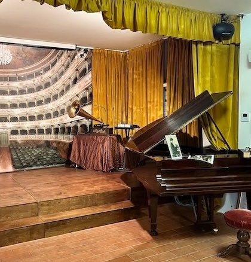
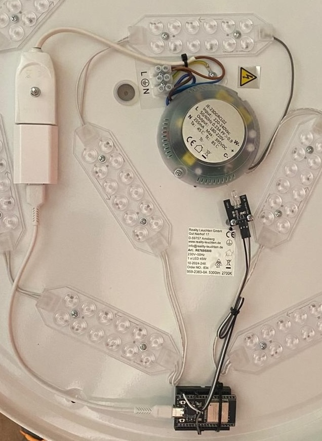

# VillaSilvia — IoT Smart Museum

An IoT system developed for the **Bonci room at the Museum of Mechanical Music, Villa Silvia-Carducci, Cesena**, to coordinate video, audio and lighting during guided visits.

The project connects previously independent devices through a local MQTT network. Proximity sensors trigger multimedia stations, while a central coordinator adjusts ambient audio and lighting to support the guide's narration.

Developed as part of my **BSc thesis in Computer Science and Engineering at the University of Bologna**, academic year **2024/2025**.

  
  

*The Bonci room (left) and an existing ceiling light fitted with an ESP32-based infrared controller (right). Photos from the thesis presentation.*

**Technologies:** Java · C++ · Vert.x · MQTT · Mosquitto · Raspberry Pi · ESP32 · Pi4J · JavaFX · PlatformIO

[Read the thesis (Italian)](Tesi.pdf) · [View the presentation (Italian)](Slides.pdf)

## Project highlights

- **Real museum installation:** the thesis documents on-site integration and testing of four video stations, six ceiling lights and one audio station.
- **Event-driven coordination:** video playback events drive lighting changes and ambient audio control through MQTT.
- **Embedded integration:** Raspberry Pi stations combine media playback, ultrasonic proximity sensing and network communication.
- **Retrofitting existing lights:** ESP32 modules translate MQTT commands into infrared signals, preserving the original ceiling fixtures.
- **Local operation:** the system communicates over a dedicated local network without requiring an Internet connection during visits.
- **Room controls:** sleep, wake and shutdown commands support daily operation.

## How a visit works

1. A video station detects a nearby person through its ultrasonic sensor, allowing the guide to trigger playback without a visible control panel.
2. The station starts the video and reports a `triggered` event, including its lighting configuration.
3. The coordinator schedules commands for the station's Shelly-controlled lights. The introductory station also dims the ceiling lights and stops ambient audio.
4. When playback finishes, the station reports an `ended` event. The coordinator applies the corresponding room logic; the piano station's completion restores ceiling lighting and ambient audio.

The implementation contains station-specific behavior, including a separate piano-player variant. It is tailored to the Bonci room's visit sequence.

## Architecture

| Component | Role | Main technologies |
| --- | --- | --- |
| Central coordinator | Processes events and issues room-level commands | Java, Vert.x, MQTT |
| MQTT broker | Routes messages between devices | Mosquitto |
| Four video stations | Detect proximity, play media and report events | Raspberry Pi, Java, Pi4J, local HTTP |
| Audio station | Plays ambient audio and responds to room commands | Raspberry Pi, JavaFX MediaPlayer, Vert.x |
| Ceiling-light controllers | Translate network commands into infrared signals | ESP32, C++, Arduino, PlatformIO |
| Local lighting | Switches station lights according to configured timings | Shelly devices, MQTT RPC |
| IR receiver utility | Captures the original remote-control codes during setup | ESP32, IR receiver |

## Validation

The thesis documents three stages of functional validation:

1. **Local component tests:** video and audio playback, sensors, local lights and infrared transmission.
2. **MQTT integration tests:** connection to the local network, topic subscriptions and remote execution of commands.
3. **On-site system testing:** initial tests with a reduced configuration, followed by the complete installation in the Bonci room with four video stations and six ceiling lights.

The reported checks cover coordination between subsystems and room-level sleep, wake and shutdown behavior. They are functional integration tests, not quantitative latency, energy-consumption or long-term reliability benchmarks.

## Further development

- Complete the operator dashboard and enable device-status updates.
- Move deployment parameters out of the source code into configuration files.
- Consolidate station variants and deployment scripts into a reproducible installation workflow.
- Extend automated checks for message handling and coordination logic.
- Adapt the architecture to additional rooms and multimedia devices.

## Author and academic context

**Riccardo Polazzi** — BSc in Computer Science and Engineering, University of Bologna, Cesena Campus.

**Thesis:** *Applicazione di tecnologie IoT per la realizzazione di Smart Museum: il caso di studio di Villa Silvia*.

**Supervisor:** Prof. Alessandro Ricci  
**Co-supervisor:** Franco Severi  
**Academic year:** 2024/2025
